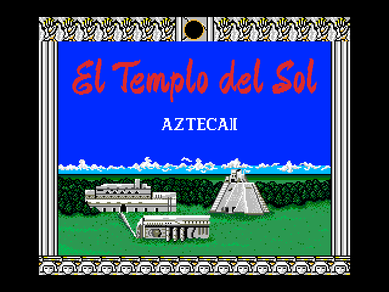
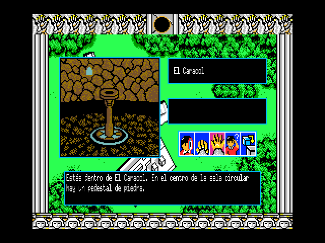
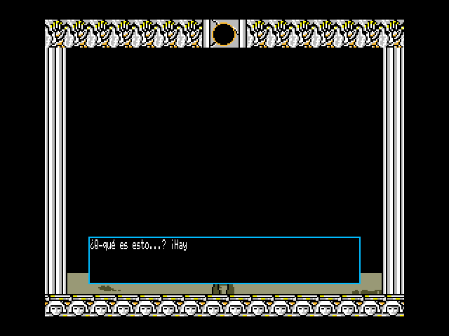

# Taiyou no Shinden - Asteka II en castellano (MSX2)

Traducción al castellano de **Taiyou no Shinden - Asteka II** (太陽の神殿 アステカII, «El Templo del Sol - Azteca II»), aventura de Tokyo Shoseki para MSX2 (1988). El diseño original es de Nihon Falcom y la versión de MSX la programó ZAP Corporation. Exploras las ruinas de Chichén Itzá (El Caracol, Las Monjas, el Cenote Sagrado...) en busca del Templo del Sol, eligiendo órdenes en menús.

Se publica como **parche IPS** para la ROM del cartucho. No se incluye ninguna ROM: necesitas tu propia copia del juego original.



## Qué tiene la traducción

* **Todo el juego en castellano**: los 456 mensajes, menús, lugares, objetos, las 73 cosas que se pueden señalar, la presentación, la pantalla de reinicio y el final, que sale palabra a palabra al ritmo del desplazamiento de la imagen.
* **Motor de texto nuevo.** La letra japonesa es de 16×16 y daba para 2 líneas de 24 letras. Ahora el texto usa una letra de 6×8, como el modo de 80 columnas del MSX2: 3 líneas de 64 caracteres, con corte por palabras, tildes, ñ, ¿ y ¡.
* **Título traducido**: «El Templo del Sol» con letra de pincel, como los kanji del original, y «AZTECAII» con las mismas letras de «ASTEKAII».
* **Créditos del final** con «CARACOL» y «(AZTECA II)» en vez de «CALACOL» y «(ASTEKA II)».
* El resaltado del menú de direcciones cubre entera cada palabra (Ade, Atr, Der, Izq, Sub, Baj).
* Se puede **guardar y cargar** como en el original, con la S-RAM del cartucho (tecla Q).

| | |
|---|---|
|  |  |

## Descargas

En [`releases/`](releases/):

| Fichero | Qué es |
|---|---|
| `Asteka2_ES_v1.0.ips` | Parche IPS. SHA-1 `c378fedf21187dcedfcde6a7a936a81360831a27`. |
| `softwaredb.xml` | Para que openMSX reconozca la ROM traducida y le ponga la S-RAM (ver abajo). |

El parche **solo** vale para esta ROM:

| ROM | Tamaño | SHA-1 |
|---|---|---|
| `Taiyou no Shinden - Asteka II. Temple of the Sun (1988)(Tokyo Shoseki)(JP)[!].rom` (TOSEC) | 262.144 bytes | `414fd2a22076f45502c2329b45bda9f8730dcaae` |
| Resultado tras aplicar el parche | 524.288 bytes | `0593546f85a2b645f5da461d761be1538744455f` |

Para aplicarlo sirve cualquier programa de parches IPS, como [Floating IPS](https://www.smwcentral.net/?p=section&a=details&id=11474) (`flips --apply Asteka2_ES_v1.0.ips original.rom Asteka2_ES.rom`), Lunar IPS o la web RomPatcher.js. Comprueba el SHA-1 de la ROM antes y después.

## Cómo jugar en openMSX (y poder guardar)

La ROM traducida es de 512 KB, mapper ASCII8 con 8 KB de S-RAM. openMSX solo pone la S-RAM si reconoce la ROM en su base de datos:

1. Copia `releases/softwaredb.xml` en la carpeta `share` de tu usuario de openMSX (en Windows, `Documentos\openMSX\share\`; en Linux, `~/.openMSX/share/`). Si ya tienes uno, añade el bloque `<software>` al tuyo.
2. Abre la ROM traducida con normalidad: openMSX la detecta sola como **ASCII8SRAM8** y crea el fichero `.SRAM`.

Sin ese fichero el juego funciona, pero se toma como ASCII8 sin S-RAM y **no se puede guardar ni cargar**.

Controles: cursores y ESPACIO (o joystick); ESPACIO corta la presentación; **Q** abre el menú SALIR / CARGAR / GUARDAR (9 huecos); el teclado numérico tiene atajos de las órdenes.

Se ha probado en openMSX con un Sony HB-F900 y se ha jugado entera, solo con el teclado.

## Guía

La [guía para terminar el juego](docs/GUIA_ASTEKA2.md) (también en [PDF](docs/GUIA_ASTEKA2.pdf)) tiene el mapa completo de 6×6 pantallas, el reloj solar, la solución paso a paso y las trampas que dejan la partida sin salida.

## Cómo se monta

Hace falta **Python 3** con **Pillow** y el ensamblador **[Pasmo](https://pasmo.speccy.org/)** en el PATH. El repositorio no incluye nada de la ROM: todo se monta sobre **tu propia copia**.

```sh
python3 build.py original.rom
# -> salida/Asteka2_ES.rom, salida/Asteka2_ES.ips (el mismo que el de releases/) y salida/softwaredb.xml
```

`build.py` comprueba el SHA-1 de la ROM original y los bytes de cada parche, genera el rótulo del título (`titulo/hace_titulo.py`), ensambla el motor, reparte los textos en bancos, avisa si alguno no cabe en su ventana y comprueba que el IPS reproduce la ROM.

## Qué hay en el repositorio

| Carpeta | Contenido |
|---|---|
| `textos/` | `traduccion.txt`: todos los textos en castellano, cada uno con su clave (la dirección del texto japonés al que sustituye). |
| `src/` | Motor de texto, enganches y rutina del título en ensamblador Z80 (Pasmo). |
| `fuente/` | Letra SCREEN0 de 6×8 (de theNestruo). |
| `titulo/` | Generador del rótulo del título y la letra Ma Shan Zheng (solo las letras usadas). |
| `build.py` | Monta la ROM traducida y el IPS a partir de tu ROM. |
| `docs/` | Guía con mapa y [documentación técnica](docs/DOCUMENTACION.md). |
| `images/` | Capturas. |
| `releases/` | El parche IPS y `softwaredb.xml`. |

## Créditos

* **Taiyou no Shinden - Asteka II** (1988): Tokyo Shoseki. Diseño original: Nihon Falcom (1986). Versión MSX: ZAP Corporation (programa K. Ishizaki, diseño K. Yano, según los créditos del final).
* **Traducción al castellano** (2026): dirección y pruebas, araubi.
* Ingeniería inversa, traducción, código y documentación: desarrollado con Claude (Anthropic).
* Letra de 6×8: `SCREEN0` de **Néstor Sancho (theNestruo)**, del repositorio [theNestruo/msxbios-tools](https://github.com/theNestruo/msxbios-tools) (`charset/custom/SCREEN0.png`, commit e7ac2f7). El repositorio no indica licencia; todos los derechos de la letra son de su autor.
* Letra del título: **Ma Shan Zheng** (The Ma Shan Zheng Project Authors), SIL Open Font License 1.1.
* Herramientas: openMSX, Pasmo.

## Licencia y avisos

* **Código y herramientas propios** (`build.py`, `src/`, `titulo/hace_titulo.py`): licencia MIT, ver [LICENSE](LICENSE).
* **Traducción, documentación y dibujos propios** (`textos/`, `docs/`, este README, el rótulo del título y la Z de los créditos): CC BY-NC-SA 4.0, ver [LICENSE-CC](LICENSE-CC).
* La letra Ma Shan Zheng va con su licencia OFL ([titulo/OFL_MaShanZheng.txt](titulo/OFL_MaShanZheng.txt)) y la letra SCREEN0 es de su autor.
* **El juego original no está cubierto por estas licencias.** Taiyou no Shinden - Asteka II, su código, gráficos, música y textos son de Tokyo Shoseki, Nihon Falcom y sus autores. Las capturas de `images/` y de la documentación muestran el juego y tampoco están cubiertas.
* Es un homenaje sin ánimo de lucro. No se incluye ninguna ROM, ni la original ni la traducida, ni los textos japoneses. Si algún titular de derechos lo pide, se retirará.
