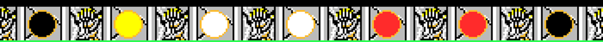
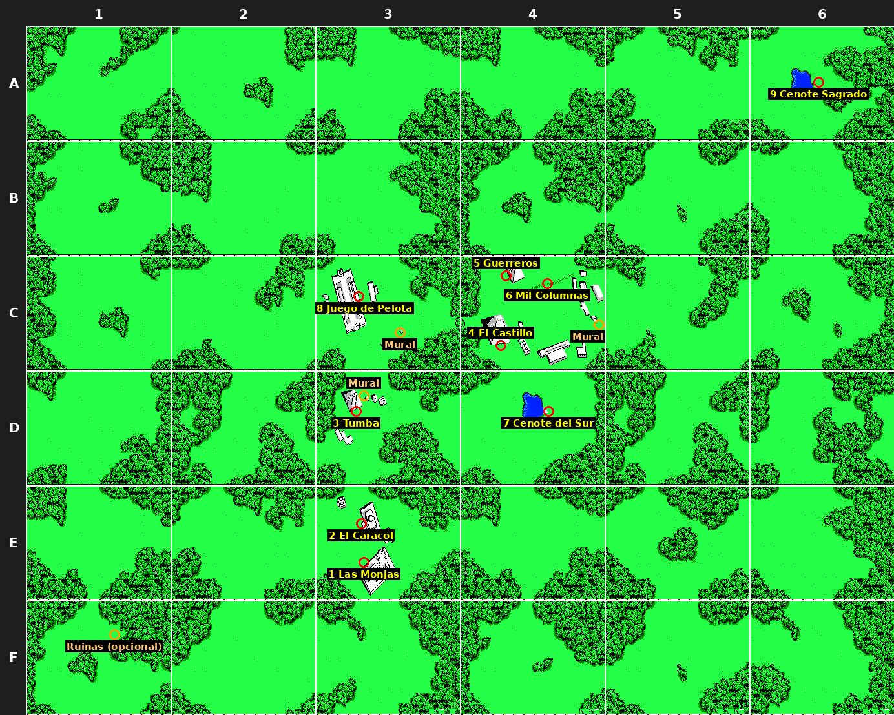
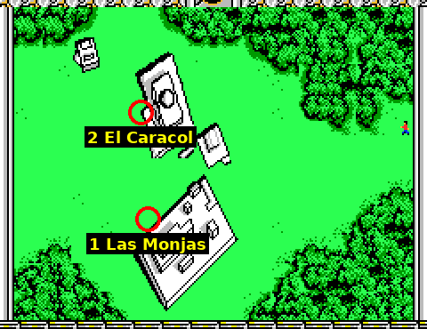
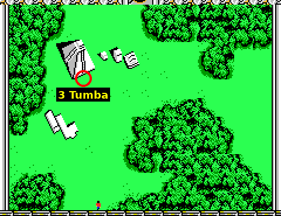
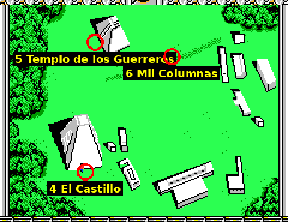
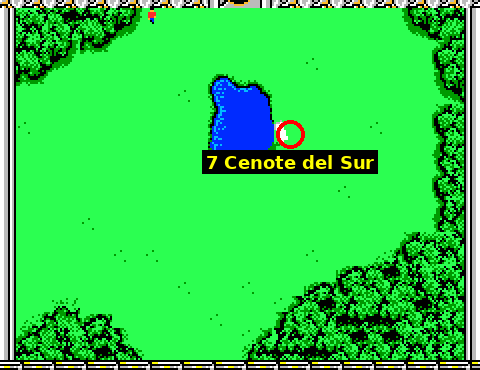
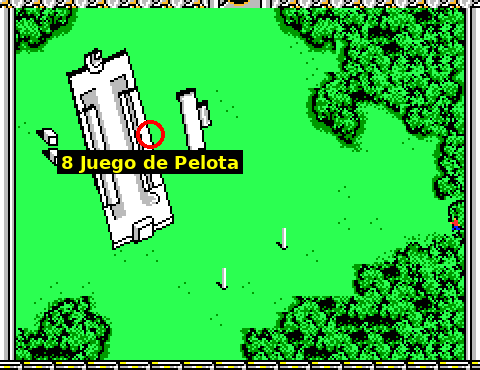
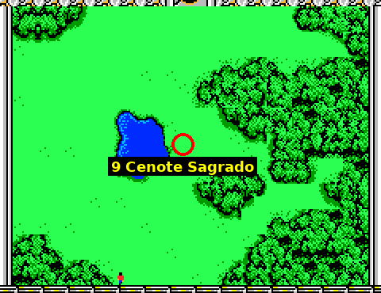
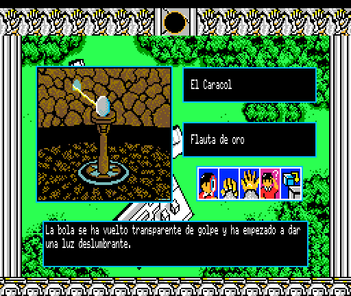
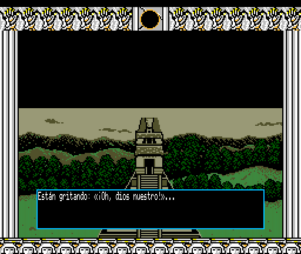

# Taiyou no Shinden - Asteka II (MSX2): guía para terminar el juego

Esta guía es para la traducción al castellano v1.0 y usa los nombres de esa traducción. La partida se jugó entera en openMSX (Sony HB-F900) solo con el teclado, de principio a fin, sin tocar la memoria. La guía japonesa de ne.jp (2008) sirvió de punto de partida, pero salió de una hoja de pistas de otra versión y en MSX2 varias cosas cambian (la luna no existe, la cabeza de oro sale en otro sitio, la llave de plata se coge por otro camino). Los pasos de abajo son los de MSX2, sacados del guion interno del juego y comprobados jugando.

## 1. Controles

- **En el mapa:** los cursores mueven al grupo. Para entrar en unas ruinas, ponte sobre la puerta y **mantén pulsado ESPACIO** medio segundo.
- **Dentro de un lugar:** abajo a la derecha hay un carrusel de 12 acciones. **← / →** cambia de acción; el icono del centro es el elegido. Las acciones, por orden, son: Mirar, Coger, Dejar, Usar, Mover, Empujar, Tirar, Romper, Juntar, Lavar, Esperar e Ir.
- **Acción sobre algo de la escena** (por ejemplo, Mirar Pared): elige la acción y pulsa ESPACIO. Elige el objeto con ← / → (el nombre sale en el recuadro) y pulsa RETURN.
- **Acción con algo que llevas** (por ejemplo, Usar Flauta de oro): elige la acción, pulsa ESPACIO y otra vez ESPACIO para abrir lo que llevas. Elige el objeto y pulsa RETURN.
- **Juntar A con B:** elige Juntar y pulsa ESPACIO, ESPACIO. Elige A y pulsa RETURN, luego elige B y pulsa RETURN. No sale ningún mensaje: el cambio se ve en el dibujo del objeto. Si vas a juntar dos veces seguidas, haz un Mirar entre las dos para que la segunda no se líe.
- **Esperar:** elige el reloj y pulsa **RETURN directamente**, sin ESPACIO. Si pulsas ESPACIO, el juego te pide un objeto y la espera no cuenta para el guion.
- **Ir:** elige el muñeco que anda y pulsa ESPACIO. Sale el menú Ade / Atr / Der / Izq / Sub / Baj (adelante, atrás, derecha, izquierda, subir, bajar). Muévete con → y pulsa RETURN.
- **Q** abre el menú de guardar. Guarda a menudo y en ranuras distintas.

## 2. El tiempo y el reloj solar

El juego lleva una hora interna: un día tiene 120 unidades y se divide en cuatro partes de 30. Cada acción adelanta 1 unidad, andar por el mapa también hace pasar el tiempo, y cada **Esperar adelanta 19**.

Arriba, en el centro, hay un círculo. Al principio siempre está negro. **Cuando lavas el Pectoral del Sol en el Cenote del Sur, se convierte en un reloj solar** y cambia de color con la hora:

| Color | Parte del día | Qué pasa |
|---|---|---|
| Rojo | 0-29 | (Ruta opcional: la cabeza de oro de las Ruinas) |
| Negro | 30-59 | Única hora en que funciona el **tarro grande de medicina** |
| Amarillo | 60-89 | — |
| Blanco | 90-119 | La luz del ventanuco descubre la **llave de cristal**; el jaguar vuelve a su templo y la flauta lo petrifica |

Si el reloj no te cuadra, haz Esperar una vez más: el color se pone al día con la siguiente acción.

## 3. El mapa

El mapa es de 6 × 6 pantallas: filas A a F (de norte a sur) y columnas 1 a 6 (de oeste a este). Empiezas en la pantalla **E3**, la de Las Monjas y El Caracol. Los círculos rojos marcan dónde hay que ponerse para entrar en cada lugar de la guía, y los naranjas los lugares opcionales: los murales y las Ruinas del templo, que no se ven hasta que pasas por encima. El bosque oscuro no se puede cruzar.

| Pantalla | Lugares | Cómo llegar |
|---|---|---|
| E3 | 1 Las Monjas, 2 El Caracol (inicio) | Desde C4: abajo (D4), abajo (E4), izquierda |
| D3 | 3 Tumba | Desde E3: arriba. Desde D3 no se puede bajar a E3: ve a la derecha (D4) y luego abajo |
| C4 | 4 El Castillo, 5 Templo de los Guerreros, 6 Mil Columnas | Desde E3: derecha (E4), arriba (D4), arriba |
| D4 | 7 Cenote del Sur | Desde C4: abajo |
| C3 | 8 Juego de Pelota | Desde C4: izquierda. Desde C3, abajo lleva a la Tumba (D3) |
| A6 | 9 Cenote Sagrado | Desde C4: derecha (C5), derecha (C6), arriba (B6), arriba. Por B5 no se pasa a A6 |

En detalle, con el lugar exacto de cada entrada:

El Cenote del Sur se entra por el lado derecho del agua. Dentro de cualquier lugar, para salir pulsa Ir Atr hasta volver al mapa. En un pasadizo, sal siempre por donde entraste.

## 4. Paso a paso

### 4.1 Las Monjas
- Mirar **Pectoral del Sol** (en la estatua del anciano) y Coger **Pectoral del Sol**. Sale «has roto el borde»: no importa.

### 4.2 Tumba del Gran Sacerdote
- Empujar **Pared**: la pared de la derecha se abre.
- Ir Der. Coger **Tesela de mosaico**: el sarcófago se abre solo.
- Coger **Máscara de un ojo**.
- Ir Izq, Ir Atr.

### 4.3 El Castillo (el tesoro)
- Ir Ade (callejón sin salida). Usar **Tesela de mosaico**: la pared sube. Ir Ade: entras en la cámara del tesoro.
- Coger **Espejo de oro** y **Vasija poco honda**. El Incensario de plata, la Vasija del jefe y la Vasija de trozos de piedra no hacen falta.
- Mover **Montón de oro**: sale la **Bola roja**.
- Mirar **Tarro**: sale la **Varita**.
- **No cojas la Peana de oro.** No hace falta, y si la llevas al coger la flauta se te cae al cenote.
- Ir Atr, Ir Atr.

### 4.4 Cenote del Sur
- Lavar **Pectoral del Sol**: la gema brilla y se enciende el reloj solar. El pectoral desaparece, pero no hace falta para nada más.
- Lavar **Espejo de oro**: queda limpio. Este paso es imprescindible para el Cenote Sagrado.
- Coger **Flauta de oro**.
- Juntar **Tirita** con **Flauta de oro**: la flauta tenía un agujero.

### 4.5 Templo de los Guerreros
- Coger **Bola de plata**.
- Coger **Joya azul**: la estatua se convierte en un jaguar de verdad. Sal con **Ir Atr**; nunca uses Ir Ade delante del jaguar, porque te mata.
- Mientras el jaguar está suelto, se aparece al entrar en El Caracol con el sol rojo, en la Tumba con el negro, en El Castillo con el amarillo y en este templo con el blanco. Si sale, escapa con Ir Atr.
- Vuelve al templo cuando el sol **no** esté blanco. Mira detrás de la estatua (Mirar **Agujero**) y Usar **Varita**: sacas la **Llavecita de hierro**.
- Haz Esperar hasta que salga «¡Ha aparecido un jaguar!», que ocurre al llegar el sol blanco.
- Usar **Flauta de oro**: el jaguar vuelve a ser de piedra para siempre.
- Coger **Joya azul**. Ir Atr.

### 4.6 El Caracol y las Mil Columnas
La bola del pedestal de El Caracol, al sonar la flauta, lanza un rayo que hace brillar una columna de las Mil Columnas. Debajo de esa columna hay algo enterrado.

1. **El Caracol:** Dejar **Bola de plata** (se coloca en el pedestal). Usar **Flauta de oro**: la bola se vuelve transparente y da luz.
2. **Mil Columnas:** Ir Ade y Mirar **Columna** («al fondo hay una columna que brilla»): te acercas a ella. Romper **Suelo de tierra** y Coger **Bola de oro**. Ir Atr, Ir Atr.
3. **El Caracol:** Coger **Bola de plata**, Dejar **Bola de oro**, Usar **Flauta de oro**.
4. **Mil Columnas:** Ir Ade, Mirar **Columna**, Romper **Suelo de tierra**, Coger **Cabeza de plata**. Ir Atr, Ir Atr.
5. **El Caracol (llave de cristal):**
   - Coger **Bola de oro** y Empujar **Pedestal**: con un estruendo aparece una escalera.
   - Ir Ade: subes al piso de arriba. Dejar **Bola de oro** en el pedestal de arriba, sin la peana.
   - Haz **Esperar** hasta que salga «La luz del sol que entra por el ventanuco izquierdo da en la bola de oro…». Pasa con el sol blanco.
   - Mirar **Pared** y Romper **Pared**. Coger **Llave de cristal**.
   - La bola de oro no hace falta más; puedes dejarla ahí. Ir Atr hasta salir.

### 4.7 Juego de Pelota (primera visita)
- Juntar **Bola roja** con **Máscara de un ojo**.
- Ir Der: es el pasadizo de los engranajes. Ir Ade: llegas al fondo.
- **Nada más llegar al fondo**, Usar **Máscara de un ojo**: ves un bloque azul a la derecha. Si avanzas antes de usarla, ya no lo verás.
- Coger **Bloque azul**.
- Ir Atr. Coger **Trinquete de piedra**: los engranajes giran y el pasadizo del fondo se cierra; lo abrirás después.
- Ir Izq, Ir Atr.

### 4.8 El Castillo (sótano de los engranajes y medicinas)
- En la primera sala, Usar **Bloque azul**: aparece una entrada en el suelo.
- Ir Baj. Dejar **Trinquete de piedra**. Mover **Manivela de piedra**: retumba un estruendo, porque los dos cenotes se vacían.
- Coger **Manivela de piedra** y Coger **Trinquete de piedra**. Ir Sub.
- Coger **Bloque azul**: la entrada se cierra, pero ya no la necesitas.
- Ir Ade (al tesoro). Dejar **Cabeza de plata**: la estatua de mujer abre una escalera.
- Ir Baj. Coger **Tarro grande de medicina** y **Tarro pequeño de medicina**.
- Ir Sub, Ir Atr, Ir Atr.

### 4.9 Cenote Sagrado (máscara de dos ojos)
Antes de bajar, comprueba que llevas la **Llave de cristal** y el **Espejo de oro limpio**. Al entrar, la salida se cierra a tus espaldas.
- Ir Baj: el cenote está seco.
- Mover **Cabeza de la estatua derecha** (el anciano de cara enfadada): se abre una puerta. **No toques nunca la estatua izquierda.**
- Ir Ade: es la cámara del ataúd y la salida se cierra.
- **Primero** Usar **Espejo de oro**: la luz del techo se refleja en el emblema y se abre una salida.
- **Después** Mirar **Ataúd** y Usar **Llave de cristal**: el ataúd se abre. Coger **Máscara de dos ojos**.
- Ir Atr, Ir Ade: sales al sótano de El Castillo. Ir Sub, Ir Atr, Ir Atr.

### 4.10 Juego de Pelota (engranajes y bloque blanco)
- Juntar **Bola roja** con **Máscara de dos ojos**. Haz un Mirar cualquiera y Juntar **Joya azul** con **Máscara de dos ojos**.
- Ir Der. Dejar **Manivela de piedra**, Dejar **Trinquete de piedra**, Mover **Manivela de piedra**. Así la puerta del pasadizo queda abierta para siempre.
- Ir Ade, Ir Ade (esta vez avanza hasta el final). Usar **Máscara de dos ojos**: ves un bloque blanco a la izquierda.
- **Empujar** el **Bloque blanco**: la pared se abre. **No lo cojas.**
- Sal: Ir Atr, Ir Atr, Ir Izq, Ir Atr.

### 4.11 Tumba (la llave de plata por el laberinto)
- Juntar **Vasija poco honda** con **Varita**: la varita hace de brújula.
- Ir Der. Mover **Calavera** y Usar **Llavecita de hierro** («ha sonado un clic»).
- Empujar **Sarcófago**: debajo hay un pasadizo. Ir Baj.
- Usar **Vasija poco honda**: siguiendo la varita llegas a una salita con la llave de plata.
- Coger **Llave de plata**: la salida de la derecha se cierra.
- Ir Izq: apareces en el pasadizo del Juego de Pelota.

### 4.12 Templo del Sol y final
- Desde ahí, Ir Ade y luego Ir Izq: es la sala del Templo del Sol, un templo en miniatura.
- Espera al **sol negro** con Esperar. Usar **Tarro grande de medicina**: te encoges.
- Ir Ade (entras en el templo). Usar **Llave de plata**: chasquido y el templo tiembla.
- Ir Atr. Usar **Tarro pequeño de medicina**: recuperas tu tamaño.
- Mover **Templo del Sol** («se ha abierto»). Coger **Llave del Sol**.
- Ir Der, Ir Atr, Ir Atr, Ir Izq: vuelves a la cancha.
- **Ir Atr con la Llave del Sol empieza el final.**

## 5. Trampas que impiden terminar

- **Sala de la llave de plata por el lado del Juego de Pelota:** desde el fondo del pasadizo, con el bloque azul ya cogido, Ir Der lleva a la sala de la llave. Si coges la llave entrando por ahí, te quedas encerrado. Cógela solo por el laberinto de la Tumba (4.11).
- **Cenote Sagrado:** el espejo va antes que la llave de cristal. Con el ataúd abierto, la luz desaparece y no hay salida. Mover la estatua izquierda primero también bloquea la puerta.
- **Tarro grande de medicina** bebido fuera del sol negro: se pierde y no hace nada.
- **Bloque blanco:** si lo coges en vez de empujarlo, la pared no se abre nunca.
- **Pectoral:** si no lo lavas antes de vaciar los cenotes (4.8), te quedas sin reloj solar. Se puede terminar, pero a ciegas con la hora.
- **Peana de oro:** si la llevas al coger la flauta, se cae al cenote. En esta ruta no hace falta.
- **Jaguar despierto:** Ir Ade delante de él es la muerte.
- **Ruta alternativa del Juego de Pelota:** si pones la cabeza de oro en la estatua de la cancha y Rompes la pared del callejón, el techo se hunde y mueres.

## 6. Cosas que no hacen falta
Incensario de plata, Copal y Bolsa de piel (encienden incienso con el Mechero y revelan murales con pistas), Vasija del jefe, Vasija de trozos de piedra (en MSX2 está vacía), Peana de oro y la **cabeza de oro**. La cabeza de oro está en las Ruinas del templo (pantalla F1): hay que Coger el Bloque rojo con el sol rojo. Abre un camino alternativo al Templo del Sol desde la estatua del Juego de Pelota. Ese camino no se ha comprobado jugando y no hace falta.

## 7. Cómo se ha comprobado
- **Partida completa en openMSX** (traducción v1.0, Sony HB-F900), solo con teclas, de la partida nueva hasta la pantalla final. Se guardó el estado en cada hito y desde ahí se siguió, sin escribir nunca en la memoria. Hubo pruebas fallidas: la llave de plata cogida por el lado del Juego de Pelota y el espejo usado después de abrir el ataúd. Ahí se volvió al estado anterior, y por eso esas trampas están en el apartado 5.
- **Lavar el pectoral (4.4):** se comprobó aparte, desde el estado de llegada al Cenote del Sur. Allí se vio cómo cambia el reloj con cada Esperar, en el orden de la tabla.
- **Las condiciones** (horas, orden de los pasos, trampas) se sacaron del guion interno del juego, descifrado del cartucho, y se cruzaron con lo que pasaba jugando.
